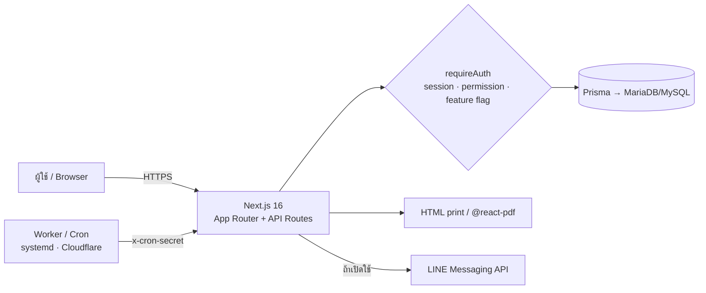

<div align="center">

# 🏛️ EMS — Employee Management System

**ระบบบริหารงานบุคคลและงานธุรการสำหรับหน่วยงาน** · ลา · เวร · หนังสือ · แบบฟอร์ม · วัสดุ/ครุภัณฑ์ · ติดตามงาน

*An open, self-hosted office & HR management system built for Thai government-style units.*


</div>

> ⚠️ **สถานะ: อยู่ระหว่างพัฒนา** — ยังไม่ได้ระบุไลเซนส์ (ยังไม่อนุญาตให้นำไปใช้ซ้ำ/เผยแพร่ต่อตามกฎหมายจนกว่าจะมี `LICENSE`) · API และโครงสร้างฐานข้อมูลอาจเปลี่ยนได้
> *Work in progress. No license has been chosen yet, so all rights are reserved for now.*

---

## ✨ ภาพรวม

EMS ออกแบบให้ **แต่ละหน่วยงานติดตั้งชุดของตัวเอง** — จำนวนบัญชี = กำลังพลจริงของหน่วยงานนั้น ไม่มีรายชื่อ/รหัสผ่านตัวอย่างมาให้
เมื่อติดตั้งใหม่ ระบบสร้าง **Super Admin เพียงบัญชีเดียว** และเปิดเฉพาะแท็บหลักเท่านั้น จากนั้น Super Admin เลือกเปิดฟีเจอร์ที่หน่วยงานต้องใช้

| | |
|---|---|
| 🧩 **เปิด/ปิดฟีเจอร์ได้** | Super Admin เปิด–ปิดทีละฟีเจอร์ พร้อมตั้งค่าเริ่มต้นของแต่ละฟีเจอร์ ปิดแล้วทั้งเมนู หน้า และ API ถูกปิดจริง (ข้อมูลไม่หาย) |
| 🏢 **ตั้งชื่อหน่วยงานได้เอง** | ชื่อสังกัด/กอง ตั้งที่เดียว แสดงในทุกแบบฟอร์มและเอกสาร |
| 🖨️ **แบบฟอร์มพิมพ์ตามต้นแบบ** | ใบลา · ใบขอรถยนต์ ฯลฯ พิมพ์/PDF ตรงตามแบบราชการ มีลายเซ็น ช่องจุดไข่ปลา และตั้งระยะขอบกระดาษแยกแต่ละแบบ |
| 🔐 **ความปลอดภัยเป็นค่าเริ่มต้น** | 2FA (TOTP) + Passkey (WebAuthn), บังคับเปลี่ยนรหัสผ่านครั้งแรก, rate limit, ป้องกัน CSRF/XSS/SQLi |

## 🗂️ ฟีเจอร์

**แท็บหลัก (ปิดไม่ได้):** หน้าหลัก · พนักงาน · ตั้งค่า · ข้อมูลส่วนตัว (เมนูรูปโปรไฟล์) · ความปลอดภัยของบัญชี

**ฟีเจอร์เสริม (Super Admin เปิด/ปิด):**

| ฟีเจอร์ | ทำอะไรได้ |
|---|---|
| 📝 การลา | ยื่นใบลา/ใบมาสาย/ใบออกก่อนเวลา, ลำดับอนุมัติ, พิมพ์แบบฟอร์ม |
| 📅 ตารางเวร | จัดเวรประจำกอง, วันหยุด |
| 📨 หนังสือเข้า-ออก | ทะเบียนหนังสือ, แนบไฟล์, ส่งออก |
| 📄 แบบฟอร์ม | แบบฟอร์มที่แอดมินสร้างเอง (Form Builder), ขอรถยนต์, ขอใช้ห้องประชุม ฯลฯ, กำหนดผู้มีสิทธิ์ขอ/อนุมัติ |
| 📦 วัสดุ | สต็อก รับ–จ่าย หมวดหมู่ |
| 🖥️ ครุภัณฑ์ | ทะเบียนครุภัณฑ์, ยืม–คืน, นำเข้าจากไฟล์ |
| ✅ ติดตามงาน | Kanban, โฟลเดอร์งาน, เตือนก่อนครบกำหนด |
| 🔔 แจ้งเตือน LINE | เตือนงานตามเวลา / แจ้งขั้นตอนใบลา (ตั้งค่า `LINE_*` ใน env) |

รายละเอียดการทำงานของสวิตช์ฟีเจอร์: [`docs/FEATURES.md`](docs/FEATURES.md)

## 🚀 เริ่มต้นใช้งานเร็ว

ต้องมี Node.js 20+, pnpm และ MariaDB/MySQL

```bash
pnpm install
cp .env.example .env              # แก้ DATABASE_URL, TWO_FACTOR_ENC_KEY, CRON_SECRET, SEED_ADMIN_PASSWORD
pnpm prisma migrate deploy        # สร้างตาราง
pnpm db:seed                      # สร้าง Super Admin 1 บัญชี + ข้อมูลเริ่มต้น
pnpm dev                          # http://localhost:3000
```

เข้าสู่ระบบด้วยบัญชีที่ seed สร้าง → ระบบบังคับเปลี่ยนรหัสผ่านและตั้ง passkey → ตั้งชื่อหน่วยงาน → เปิดฟีเจอร์ → เพิ่มพนักงาน (ทีละคนหรือนำเข้า CSV)
ขั้นตอนเต็ม: **[`docs/GETTING-STARTED.md`](docs/GETTING-STARTED.md)** · ตัวอย่างไฟล์นำเข้า: [`docs/employees-import-template.csv`](docs/employees-import-template.csv)

## 🏗️ สถาปัตยกรรม



- **Auth & สิทธิ์:** session cookie, 2FA/Passkey, บทบาท `EMPLOYEE → MANAGER → DIRECTOR → ADMIN → SUPER_ADMIN` + สิทธิ์รายบุคคล/ราย role ที่แอดมินปรับได้
- **Feature guard:** ตรวจที่จุดเดียวใน `requireAuth()` — ปิดฟีเจอร์แล้ว API ตอบ `403 FEATURE_DISABLED`
- **แบบฟอร์ม:** เลย์เอาต์แบบ declarative ใช้ร่วมกันทั้งหน้าพิมพ์ HTML และ PDF

```text
src/app/            หน้าและ API routes (App Router)
src/lib/            ตรรกะหลัก: auth, permissions, features, org-settings, form-requests, security
src/components/     UI และแบบฟอร์ม/PDF
prisma/             schema, migrations, seed (seed-lib.ts)
worker/ systemd/    งานเตือนตามเวลา
e2e/ tests/         Playwright และตัวช่วยเทสฐานข้อมูล
docs/               เอกสาร
```

## 🔒 ความปลอดภัย

บัญชีเริ่มต้นบัญชีเดียวและต้องเปลี่ยนรหัสทันที · 2FA บังคับ · Passkey · ล็อกบัญชีเมื่อเดาผิด · CSRF/Origin check · CSP · path normalization กัน bypass ฟีเจอร์ · ความลับทั้งหมดมาจาก env (ไม่มีค่าฝังในโค้ด)
รายละเอียดและตาราง environment: **[`docs/SECURITY.md`](docs/SECURITY.md)**

**พบช่องโหว่?** กรุณาแจ้งแบบส่วนตัวผ่าน GitHub → *Security → Report a vulnerability* ก่อนเปิดเผยสาธารณะ

## 🧪 การทดสอบ

```bash
pnpm test:db:up        # MariaDB สำหรับเทส (docker, พอร์ต 3307)
pnpm test              # vitest — เทสหน่วย + integration บนฐานข้อมูลจริง
pnpm test:e2e          # Playwright (ล็อกอิน + TOTP จริง) — เปิด next dev ของตัวเองที่พอร์ต 3100; ถ้ามี next dev ค้างในโฟลเดอร์เดียวกันให้หยุดก่อน
pnpm test:db:down
```

เทสทุกชุดมีตัวกัน (`tests/db-guard.ts`) ไม่ให้รันกับฐานข้อมูลที่ไม่ใช่ `ems_test`

## ⚙️ คำสั่งที่ใช้บ่อย

| คำสั่ง | ความหมาย |
|---|---|
| `pnpm dev` / `pnpm build` / `pnpm start` | พัฒนา / บิลด์ / รัน production |
| `pnpm db:seed` | ข้อมูลเริ่มต้น + Super Admin (รันซ้ำได้ ไม่ทับของเดิม) |
| `pnpm db:backup` · `db:restore` | สำรอง/กู้คืนฐานข้อมูล |
| `pnpm worker:reminders` | worker เตือนงาน ([`docs/CRON_SETUP.md`](docs/CRON_SETUP.md)) |
| `pnpm lint` | ESLint |

การติดตั้งบน Synology NAS: [`docs/DEPLOYMENT-SYNOLOGY.md`](docs/DEPLOYMENT-SYNOLOGY.md)

## 🤝 ร่วมพัฒนา

ยินดีรับ issue และ pull request — กรุณารัน `pnpm lint`, `pnpm test` ให้ผ่านก่อนส่ง และอย่าใส่ข้อมูลบุคคลจริง (ชื่อ เบอร์ อีเมล) ในโค้ด เทส หรือภาพหน้าจอ
การเพิ่มฟีเจอร์ใหม่ให้ทำตามขั้นตอนใน [`docs/FEATURES.md`](docs/FEATURES.md#เพิ่มฟีเจอร์ใหม่)

## 📄 ไลเซนส์

ยังไม่ระบุ (อยู่ระหว่างพัฒนา) — จะประกาศเมื่อพร้อมเผยแพร่เป็นโอเพนซอร์สเต็มรูปแบบ
ฟอนต์ TH Sarabun ใน `public/fonts/` อยู่ภายใต้ *DIP&SIPA Font License* (ดูไฟล์ในโฟลเดอร์เดียวกัน)
